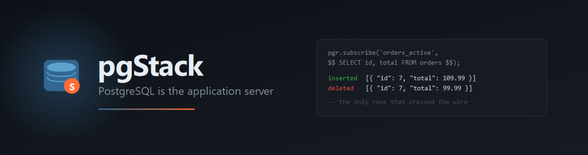

# pgStack

[](https://github.com/ndokutovich/pg_reactive/actions/workflows/ci.yml)
[](https://www.npmjs.com/package/pgstack)
[](https://www.npmjs.com/package/pgstack)
[](https://hub.docker.com/r/pgstack/pgstack-proxy)
[](#license)


**An open-source Supabase alternative you can run on any VPS with one `docker compose up`.**

Auth (email + OAuth), PostgREST-compatible REST API, realtime subscriptions,
edge functions, file storage, a Studio admin UI — all backed by stock
PostgreSQL and shipped as a small set of containers. No managed-cloud
lock-in, no per-row pricing, no proprietary protocol on top of PG.

> **Looking for the PostgreSQL extension on its own?** pgStack's realtime
> layer is powered by [`pg_reactive`](ext/README.md) — a standalone PG
> extension that turns any `SELECT` into a live query. Use it without
> pgStack if all you need is reactive SQL.

## What's in the box

| Component | What it does | Where |
|-----------|--------------|-------|
| **Go proxy** (`proxy-go/`) | chi-based server: REST, Auth, Realtime, Edge Functions, Storage, RLS middleware, rate limiting, TLS via Let's Encrypt | One binary, one container |
| **Studio** (`studio/`) | React SPA: table editor, SQL editor, auth users, realtime channels, logs | Served at `/studio/` |
| **TypeScript SDK** (`sdk/`) | `PgStackClient` (REST + auth + realtime + functions), React hooks, server-side admin, generic query builder, DBOS-style job queue | `@pgstack/sdk` on npm |
| **CLI** (`cli/`) | `pgstack init`, `pgstack dev`, migration management, type generation, project scaffolding | `pgstack` on npm |
| **pg_reactive** (`ext/`) | PostgreSQL extension: live `SELECT` subscriptions with delta `NOTIFY`s. The realtime backend pgStack uses | Standalone — see [`ext/README.md`](ext/README.md) |

## Install

Nothing below requires cloning the repository. Pick the row that matches what
you want to run — the whole platform, the client library, or the extension on
its own.

| You want | Use |
|---|---|
| A new project, wired and running | [`npx pgstack init`](#1--scaffold-a-project-cli) |
| The platform on a server | [Docker images](#2--the-platform-as-containers) |
| The SDK in an existing app | [`npm install @pgstack/sdk`](#3--the-sdk-in-your-app) |
| Only reactive SQL, inside your own cluster | [PGXN](#4--the-extension-alone) |

### 1 — Scaffold a project (CLI)

Generates a `docker-compose.yml`, an `.env` with freshly generated secrets, a
migration directory and a starter page. The compose file uses the published
images, so nothing is compiled.

```bash
npx pgstack init my-app
cd my-app
npx pgstack dev
```

Then:

- REST: `http://127.0.0.1:8080/rest/v1/{table}`
- Auth: `http://127.0.0.1:8080/auth/v1/...`
- Realtime (WebSocket): `ws://127.0.0.1:8080/ws/{query_id}`
- Studio: `http://127.0.0.1:8080/studio/`
- Postgres: `127.0.0.1:15432`

### 2 — The platform as containers

Four images, published to both registries on every release. Tags are the
version (`0.3.3`), the minor line (`0.3`) and `latest`.

| Image | Docker Hub | GHCR |
|---|---|---|
| Go proxy | `pgstack/pgstack-proxy` | `ghcr.io/ndokutovich/pgstack-proxy` |
| PostgreSQL 16 + `pg_reactive` | `pgstack/pgstack-postgres` | `ghcr.io/ndokutovich/pgstack-postgres` |
| PostgreSQL + extension + proxy in one container | `pgstack/pgstack-all-in-one` | `ghcr.io/ndokutovich/pgstack-all-in-one` |
| Rust proxy (security-parity sibling) | `pgstack/pgstack-proxy-rust` | `ghcr.io/ndokutovich/pgstack-proxy-rust` |

```bash
# any image in the table above, at a pinned release:
docker pull pgstack/pgstack-all-in-one:0.3.3
```

For a real deployment, [`docker-compose.prod.yml`](docker-compose.prod.yml)
puts the same images behind persistent volumes, resource limits and the strict
production validator, with TLS delegated to a reverse proxy by default:

```bash
curl -fsSLO https://raw.githubusercontent.com/ndokutovich/pg_reactive/master/docker-compose.prod.yml
curl -fsSLO https://raw.githubusercontent.com/ndokutovich/pg_reactive/master/.env.example
cp .env.example .env          # fill in the secrets; see "Configuration" below
docker compose -f docker-compose.prod.yml up -d
```

Compose fail-fasts with `POSTGRES_PASSWORD required` (and so on) rather than
starting with a half-configured stack, and the proxy repeats the check at boot:
in `PGSTACK_ENV=production` it refuses placeholder values, short keys, and a
missing SMTP configuration.

### 3 — The SDK in your app

```bash
npm install @pgstack/sdk
```

REST, auth, realtime and edge functions against any pgStack instance — see
[Use it from your app](#use-it-from-your-app) below.

### 4 — The extension alone

Just the `pg_reactive` C extension in an existing PostgreSQL 15–18 cluster, no
proxy and no pgStack. Deltas arrive as JSON on the `pgr` NOTIFY channel, so any
`LISTEN`-capable client can consume them.

```bash
pgxn install pg_reactive          # https://pgxn.org/dist/pg_reactive/
```

```ini
# postgresql.conf
shared_preload_libraries = 'pg_reactive'
```

Restart PostgreSQL, then `CREATE EXTENSION pg_reactive;`. See
[`ext/README.md`](ext/README.md) for the `pgr.subscribe()` API.

The extension versions on its own line — 0.1.8 today, while the platform is at
0.3.3 — because it has its own release cadence and its own license.

### From source

[`CONTRIBUTING.md`](CONTRIBUTING.md) covers cloning and `docker compose up
--build`, which compiles the extension and both proxies locally.

## Configuration

Copy `.env.example` to `.env` and fill it in. The secrets that must be real —
variables the stack will refuse to start without — are listed with generation
recipes in [`docs/site/docs/installation.md`](docs/site/docs/installation.md).

## Use it from your app

```typescript
import { createClient } from "@pgstack/sdk/pgstack";

const client = createClient("http://127.0.0.1:8080", process.env.PGSTACK_ANON_KEY!);

// Auth
await client.auth.signUp({ email, password });
const { data: auth } = await client.auth.signInWithPassword({ email, password }); // session at auth.session

// REST (PostgREST-compatible)
const { data: orders } = await client.from("orders")
  .select("id, total, status, customer:customers(name)")
  .eq("status", "open")
  .order("total", { ascending: false })
  .limit(20);

// Realtime — same wire format as pg_reactive (root entry, not the pgstack client)
import { createClient as createLiveClient } from "@pgstack/sdk";
const live = createLiveClient({ url: "ws://127.0.0.1:8080" }).subscribe("orders_q");
live.on((event, data) => { /* delta / overflow / invalidated */ });

// Edge functions
const { data } = await client.functions.invoke("process-order", {
  body: { orderId: 123 },
});
```

## Deploying

Two compose files ship, for two network postures.

- **[`docker-compose.prod.yml`](docker-compose.prod.yml)** — one box. Binds the
  proxy to `127.0.0.1:8080` and leaves TLS to a reverse proxy in front
  (`TLS_MODE=off`); set `TLS_MODE=auto` to have the proxy fetch certificates
  itself through ACME.
- **[`examples/docker-compose.prod.yml`](examples/docker-compose.prod.yml)** —
  overlay for a shared gateway: publishes no host ports, expects traffic
  through your own reverse proxy on a `gateway` network, and stacks the
  production guards on top of `examples/docker-compose.yml`.

Both fail fast on missing secrets and run the same `PGSTACK_ENV=production`
validator. Generate every secret once:

```bash
bash scripts/bootstrap-env.sh   # idempotent; never overwrites existing values
docker compose -f docker-compose.prod.yml up -d
```

Full deployment guide: [`docs/site/`](docs/site/). The CI/CD pipeline that
builds and promotes these images is documented in
[`docs/DEPLOYMENTS.md`](docs/DEPLOYMENTS.md).

## Architecture at a glance

```
+--------------------+           +-----------------------+           +-------------------+
|  PostgreSQL        |           |  Go proxy (chi)       |           |  Browser / Node   |
|                    |   NOTIFY  |                       |    WS     |                   |
|  pg_reactive ext   | --------> |  Realtime backend     | --------> |  @pgstack/sdk  |
|  (realtime         |           |                       |           |  React hooks      |
|   backend)         |           |  Auth / OAuth         |   REST    |  Studio           |
|                    |           |  REST + RLS           | <-------> |                   |
|                    |  pgx pool |  Edge Functions       |           |                   |
|                    | <-------- |  Storage              |           |                   |
+--------------------+           +-----------------------+           +-------------------+
                                          |
                                          | static
                                          v
                                  +---------------+
                                  |  Studio SPA   |
                                  |  (React)      |
                                  +---------------+
```

Realtime today is `pg_reactive` (LISTEN/NOTIFY, low-latency, column-level
invalidation). Polling, logical-replication, or CDC backends could be added
behind the same proxy in the future for workloads where NOTIFY's profile
doesn't fit.

## Features

**Auth**
- Email + password (Argon2id), OAuth (Google, GitHub, Apple, Microsoft, generic OIDC), magic links,
  email verification, password reset, admin user CRUD.
- Refresh-token rotation with family-based reuse detection.
- JWT issuance, RLS context injection.

**REST (PostgREST-compatible)**
- CRUD on any table.
- Filter operators: `eq`, `neq`, `gt`/`gte`/`lt`/`lte`, `like`, `ilike`,
  `in`, `is`, `cs`/`cd` (array contains), `fts`, `not.*`, `or()`, `and()`.
- Resource embedding via FK joins: `select=id,title,authors(name)`.
- Pagination, ordering, column selection, `Content-Range` + `Prefer: count=exact`.
- RPC for SQL functions (scalar and set-returning).
- Transaction batching: `POST /rest/v1/batch` with `{{op.field}}` templates
  (atomic + partial modes).

**Realtime**
- Live queries via `pg_reactive`: subscribe to any `SELECT`, receive deltas
  on insert/update/delete. Column-level invalidation tracking.
- Audience-bound subscriptions: server-side enforcement that only matching
  JWTs receive a delta.
- Multi-client fan-out, presence channels, broadcast.

**Edge Functions**
- Five runtimes: Deno reverse-proxy (Supabase-compatible), embedded goja
  JS, PL/v8, PL/Python, and `http` (per-function container in any language).
- Env vars encrypted at rest (AES-256-GCM under `SECRETS_ENCRYPTION_KEY`).
- Uniform `EDGE_FN_TIMEOUT_MS` deadline.

**Storage**
- File upload/download with MIME validation, size limits, RLS-aware
  bucket/object permissions.
- Database-backed or filesystem-backed.

**Webhooks**
- Outbound HTTP webhooks on table events.
- Signing secret stored encrypted; SSRF-hardened delivery (refuses
  loopback, private, link-local, IANA-reserved IPs); fail-closed refresh.

**Studio UI**
- Table editor (CRUD), SQL editor with history, auth user management,
  database browser, realtime channel inspector, logs viewer.

**Operability**
- HSTS, CSP, `Permissions-Policy`, strict CORS by default.
- Rate limiting (per-IP, with `TRUSTED_PROXIES` for X-Forwarded-For).
- `LOG_LEVEL` env, structured JSON logs (zerolog).
- Graceful shutdown, healthcheck endpoint.

## Documentation

- **Full docs site** (Docusaurus 3): [`docs/site/`](docs/site/)
- **Architecture & dev workflow**: [`CLAUDE.md`](CLAUDE.md)
- **Security policy**: [`SECURITY.md`](SECURITY.md)
- **Security audit** (Critical/High/Medium remediated): [`docs/SECURITY_AUDIT_2026-03-07.md`](docs/SECURITY_AUDIT_2026-03-07.md)
- **Contributing**: [`CONTRIBUTING.md`](CONTRIBUTING.md)
- **Changelog**: [`CHANGELOG.md`](CHANGELOG.md)

## Testing

292 unit tests (SDK 92, CLI 160, Studio 40) plus 41 end-to-end, security and
integration scripts, 21 regression and isolation files, and 7 perf benchmarks —
all run in CI on every push. Per-component commands are in
[`CLAUDE.md`](CLAUDE.md). At the highest level:

```bash
# Extension (pg_regress + isolation)
docker compose exec -T db bash -c 'su - postgres -c "cd /ext/ext && make installcheck && make isolation_installcheck"'

# Go proxy unit tests
cd proxy-go && go test ./...

# SDK + CLI
cd sdk && npm test
cd cli && npm test

# E2E (requires docker compose up)
node tests/e2e_ws_test.mjs       # …and 23 other E2E suites
bash tests/perf/runner.sh         # full perf suite (~10 min)
```

## Project layout

```
ext/                  pg_reactive PostgreSQL extension (own README, own LICENSE)
proxy-go/             Go proxy: REST, Auth, Realtime, Edge Functions, Storage
studio/               React Studio SPA
sdk/                  TypeScript SDK (@pgstack/sdk)
cli/                  pgstack CLI tool
docker/               Production Dockerfiles + init.sql + entrypoint
examples/             Demo apps + production compose overlay
tests/                E2E, integration, performance
docs/                 Docusaurus site + security audit + plans
scripts/              bootstrap-env.sh and friends
```

## Requirements

**To run a published artifact:** Docker 20.10+ with Compose v2 — or nothing at
all if you only take the SDK, and a PostgreSQL 15–18 cluster if you only take
the extension. Every PostgreSQL major is CI-proven with the full regression and
isolation suite on bare PGDG images; the bundled images ship PostgreSQL 16.

**To build from source:** Docker and Compose, Go 1.26.10 (the CI-verified
toolchain, on which `govulncheck` is clean), and Node.js 24 for the SDK and CLI
build chains. The pinned versions live in [`docs/VERSIONS.md`](docs/VERSIONS.md)
and are re-checked weekly by CI.

## License

This repository is dual-licensed because it ships two different things:

- **PostgreSQL extension** (`ext/`) is licensed under the **PostgreSQL License**
  — the same license PostgreSQL itself uses. See [`ext/LICENSE`](ext/LICENSE).
  This is the right license for an extension distributed via PGXN or installed
  into a vanilla PostgreSQL cluster.
- **Everything else** — Go proxy, TypeScript SDK, Studio, CLI, examples,
  infrastructure, docs — is licensed under the **Apache License 2.0**. See
  [`LICENSE`](LICENSE) and [`NOTICE`](NOTICE).

Both licenses are permissive and mutually compatible. If you redistribute a
bundled product (e.g. a single Docker image containing both components), you
must comply with both. By submitting a pull request you agree to license your
contribution under the license of the directory it lands in — see
[`CONTRIBUTING.md`](CONTRIBUTING.md).

Security reports: see [`SECURITY.md`](SECURITY.md).
