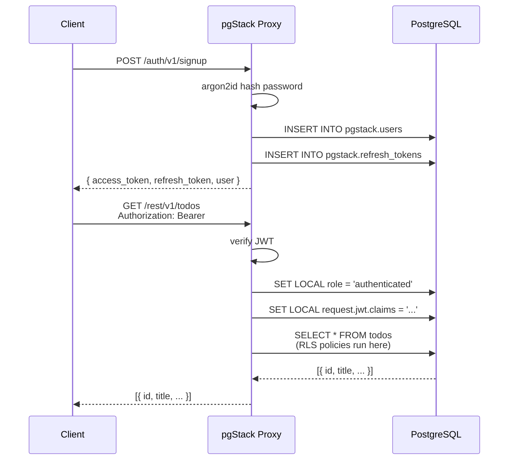
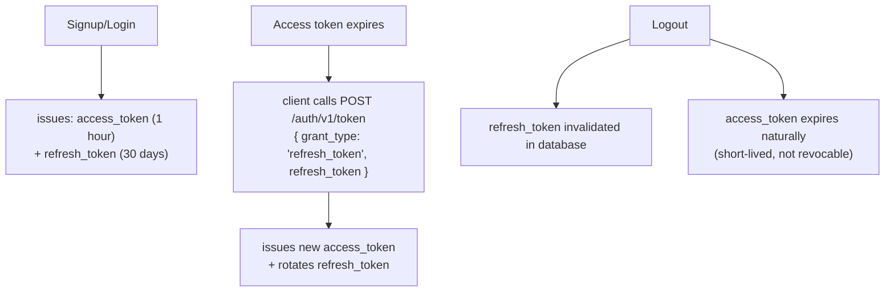

# Authentication Overview

pgStack ships a complete authentication system built directly into the proxy. No external auth service required.

## How it works



## Token format

pgStack uses **JWT (HS256)** signed with your `JWT_SECRET`.

Access token claims:

```json
{
  "sub": "user-uuid",
  "email": "user@example.com",
  "role": "authenticated",
  "iat": 1700000000,
  "exp": 1700003600
}
```

The `role` claim is the PostgreSQL role that runs your queries. pgStack sets this as the active role before executing REST requests, enabling RLS to work automatically.

## Database schema

Auth data is stored in the `pgstack` schema:

```sql
pgstack.users           -- user accounts
pgstack.refresh_tokens  -- long-lived refresh tokens
pgstack.oauth_sessions  -- OAuth PKCE state
pgstack.email_tokens    -- email verification / recovery / magic-link tokens (hashed)
```

This schema is created by the pgStack bootstrap SQL (`docker/init.sql` in the dev stack; laid down as your first migration by `pgstack init`). You should not modify it directly.

## Password security

Passwords are hashed with **argon2id** using memory-hard parameters. Plain-text passwords are never stored or logged.

## Token lifecycle



Token lifetimes are configurable via environment variables:
- `ACCESS_TOKEN_EXPIRY_SECS` — default 3600 (1 hour)
- `REFRESH_TOKEN_EXPIRY_DAYS` — default 30

## Roles

pgStack uses three PostgreSQL roles:

| Role | Description | Who uses it |
|------|-------------|-------------|
| `anon` | Unauthenticated requests | Requests with `ANON_KEY` |
| `authenticated` | Signed-in users | Requests with a valid JWT |
| `service_role` | Admin, bypasses RLS | Requests with `SERVICE_ROLE_KEY` |

Your RLS policies should reference the `authenticated` role:

```sql
-- Only authenticated users can see their own rows
CREATE POLICY "Own rows only"
  ON orders FOR ALL
  USING (
    auth.role() = 'authenticated'
    AND user_id = auth.uid()
  );
```

## Helper functions

pgStack installs these helper functions in the `auth` schema (compatible with Supabase's `auth` helpers):

```sql
-- Current user's UUID (from JWT sub claim)
SELECT auth.uid();

-- Current user's role ('anon', 'authenticated', 'service_role')
SELECT auth.role();

-- Current user's email
SELECT auth.email();

-- Full JWT claims as JSONB (empty object if no JWT)
SELECT auth.jwt();
```

## API endpoints

| Method | Path | Description |
|--------|------|-------------|
| `POST` | `/auth/v1/signup` | Register a new user |
| `POST` | `/auth/v1/token` | Sign in (`grant_type` `"password"`) or refresh (`grant_type` `"refresh_token"`) — `grant_type` goes in the JSON body, not the query string |
| `GET` | `/auth/v1/user` | Get current user profile |
| `PATCH` | `/auth/v1/user` | Update user profile |
| `POST` | `/auth/v1/logout` | Sign out (invalidate refresh token) |
| `POST` | `/auth/v1/anonymous` | Anonymous sign-in — mints a short-lived `role=anon` JWT (random `sub`, no DB row, no refresh token). Default-deny: returns `503` unless the proxy runs with `ALLOW_ANONYMOUS_SIGNIN=true` |
| `POST` | `/auth/v1/recover` | Request password reset email |
| `POST` | `/auth/v1/recover/confirm` | Confirm password reset with token |
| `POST` | `/auth/v1/magiclink` | Request magic-link email |
| `GET` | `/auth/v1/magiclink/verify` | Verify magic-link token |
| `GET` | `/auth/v1/verify` | Verify email address |
| `GET` | `/auth/v1/authorize?provider=google` | Start OAuth flow |
| `GET` | `/auth/v1/callback` | OAuth callback (handled by proxy; also accepts `POST` for Apple `form_post`) |
| `GET` | `/auth/v1/admin/users` | List users (service_role) |
| `POST` | `/auth/v1/admin/users` | Create user (service_role) |
| `DELETE` | `/auth/v1/admin/users/{id}` | Delete user (service_role) |

Anonymous sign-in from the SDK:

```typescript
// Lets public-read demo pages satisfy REQUIRE_AUTHENTICATED_WS
// without embedding the raw anon key as a fake credential
const { data, error } = await pgstack.auth.signInAnonymously();
// data.session.access_token expires after ANONYMOUS_JWT_TTL (default 3600s);
// there is no refresh token
```

## Next steps

- [Email & Password Auth](./email-password) — signup, login, password reset
- [OAuth](./oauth) — Google, GitHub, Apple, Microsoft, and generic OIDC login
- [Magic Links](./magic-links) — passwordless email login
- [Row Level Security](./rls) — securing your data with RLS
