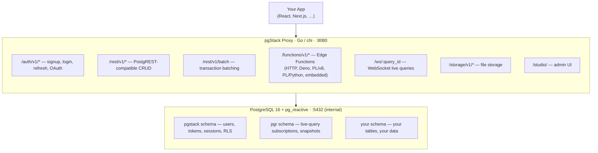

# What is pgStack?

pgStack is an open-source PostgreSQL-native backend platform — a self-hosted alternative to Supabase that runs in **two Docker containers** instead of 15+.

Everything you expect from a modern backend: authentication, a REST API, real-time subscriptions, an admin Studio, a CLI, and a TypeScript SDK — all powered by PostgreSQL, with no extra services.

## The stack

| Component | Technology | What it does |
|-----------|-----------|--------------|
| Database | PostgreSQL 16 + pg_reactive | Live queries, auth schema, your data |
| Proxy | Go (chi) | Auth, REST API, WebSockets, Edge Functions, RLS |
| Studio | React SPA | Admin dashboard at `/studio` |
| SDK | TypeScript | Client library for auth, REST, live queries |
| CLI | Node.js | Scaffold, migrate, generate types |

## Architecture overview



## Philosophy

**Zero extra services.** Redis, GoTrue, Realtime — all eliminated. PostgreSQL is the only stateful component. Sessions are rows, job queues are tables, pub/sub is `LISTEN`/`NOTIFY`.

**PostgREST-compatible REST API.** The filter syntax, embedding syntax, and response format match PostgREST. If you're migrating from Supabase, most client code works without changes.

**Real-time first.** The [`pg_reactive`](/pg-reactive/) C extension turns any `SELECT` into a live query. Changes are diffed at the SQL layer using `EXCEPT`-based comparison and delivered as JSON deltas over WebSocket. pg_reactive is a standalone PostgreSQL extension — usable on its own with nothing but `LISTEN pgr` — and has its **[own documentation section](/pg-reactive/)**; pgStack is the batteries-included platform built around it.

**RLS enforced by default.** Every REST request runs as the authenticated PostgreSQL role. The proxy sets `request.jwt.claims` and switches role before executing queries, so your `ROW LEVEL SECURITY` policies run automatically.

**Two containers.** The production stack and `pgstack init` scaffolds run just PostgreSQL + the Go proxy — `docker compose up -d` and you're done. (The development compose in this repo additionally starts a legacy Rust reference proxy on `127.0.0.1:8081`.) No Kubernetes required for development or small production deployments.

## Quick example

```bash
# Start everything
docker compose up -d

# Sign up
curl -X POST http://127.0.0.1:8080/auth/v1/signup \
  -H 'Content-Type: application/json' \
  -d '{"email":"hello@example.com","password":"strongpassword"}'

# Query your data
curl http://127.0.0.1:8080/rest/v1/todos?done=eq.false \
  -H 'Authorization: Bearer <access_token>'
```

```typescript
// TypeScript client
import { createClient } from '@pgstack/sdk/pgstack';

const pgstack = createClient('http://127.0.0.1:8080', 'your-anon-key');

// Auth
const { data } = await pgstack.auth.signInWithPassword({
  email: 'hello@example.com',
  password: 'strongpassword',
});

// REST queries
const { data: todos } = await pgstack.from('todos')
  .select('*')
  .eq('done', false)
  .order('created_at', { ascending: false });

// Live queries (WebSocket)
import { useLiveQuery } from '@pgstack/sdk/react';

function TodoList() {
  const { rows, state } = useLiveQuery('active_todos', {
    url: 'ws://127.0.0.1:8080',
    token: session.access_token,
  });
  return <ul>{rows.map(r => <li key={String(r.id)}>{String(r.title)}</li>)}</ul>;
}
```

## Next steps

- [Quick Start](./quickstart) — up and running in 5 minutes
- [Installation](./installation) — full installation options
- [vs Supabase](./vs-supabase) — feature comparison
- [pg_reactive](/pg-reactive/) — the standalone live-query extension at pgStack's core
